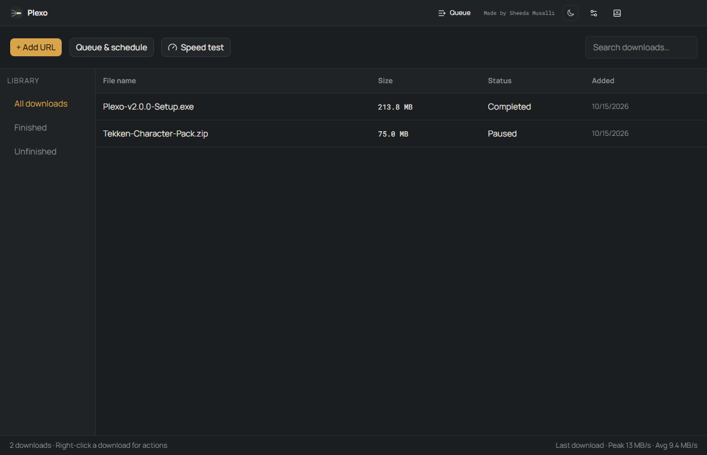
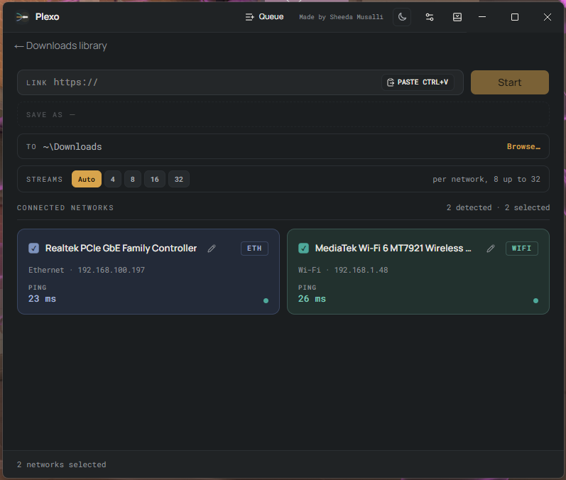
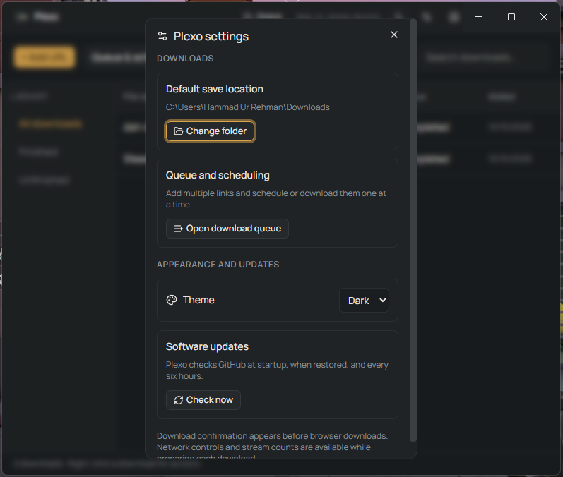
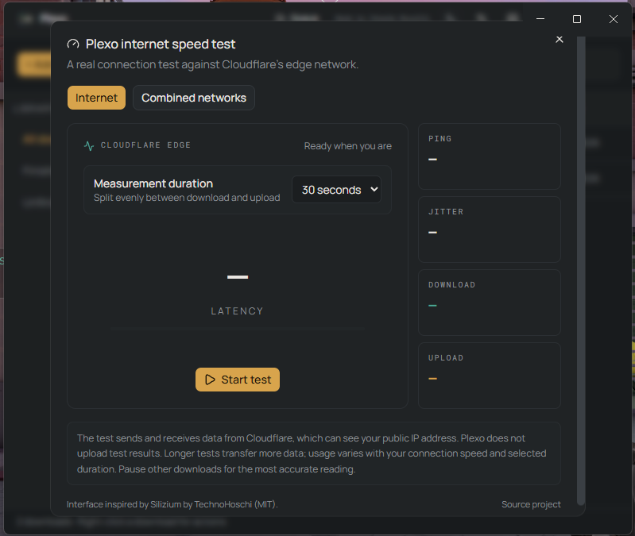

# Plexo Download Manager

[](https://github.com/SheedaMusalli/Plexo-For-Windows/releases/latest)
[](LICENSE)

Plexo is a Windows download manager with a Chrome and Edge extension. It can split supported downloads into parallel parts, use selected network connections, resume interrupted transfers, and keep a searchable download history.

**Current release: v2.0.1** Download the installer and browser extension from [GitHub Releases](https://github.com/SheedaMusalli/Plexo-For-Windows/releases/latest). Plexo for Windows is developed and maintained by **Sheeda Musalli**.

## Screenshots

**Download history**



**Preparing a download and managing the queue**




**Settings and internet speed tests**






## Download and install

1. Open the [latest release](https://github.com/SheedaMusalli/Plexo-For-Windows/releases/latest) and download `plexo-2.0.1-setup.exe`. Run it to install the Windows x64 app and register its browser helper for your Windows account.
2. Download `Plexo.Chrome.Extension.zip` from that same release and extract it into a permanent folder.
3. In Chrome, open `chrome://extensions`; in Edge, open `edge://extensions`. Turn on **Developer mode**, choose **Load unpacked**, and select the extracted folder containing `manifest.json`.
4. Pin **Plexo Download Manager** from the browser Extensions menu. Open the extension popup and confirm it says **Connected**. If you updated Plexo, use **Reload** on the extensions page and refresh existing website tabs.
5. Start a supported download from a webpage, use **Download with Plexo** on a direct link, or paste a direct URL into the desktop app. Plexo asks before adding captured downloads to its queue.

The release also includes `Plexo.Chrome.Extension.crx`, the installer update metadata, a blockmap, and `SHA256SUMS.txt`. Chrome and Edge generally restrict extensions installed outside their stores; if CRX installation is blocked, use the ZIP with **Load unpacked**. The supplied extension is the selected `1.0.0-browser.9` build and is not published on the Chrome Web Store. Keep the extracted extension folder in place so the browser can load it.

Windows may show an unknown-publisher or SmartScreen warning because the installer is not Authenticode-signed with a publisher certificate. The CRX package signature does not mean the extension is store-published or store-approved.

## Features

- **Download library:** Search and filter all, finished, and unfinished downloads. Double-click a completed item to open it; right-click for file actions and download details. The status bar shows the latest download’s peak and average speed.
- **Parallel transfers:** Split supported files across multiple streams and selected network connections. Plexo assembles the parts into one file and displays progress, speed, and network contribution.
- **Pause and recovery:** Pause, resume, or cancel transfers. Interrupted desktop downloads can be recovered when Plexo starts again.
- **Browser handoff:** Capture supported direct downloads or send a direct link from the extension. Plexo prompts before accepting the download; when it cannot accept a browser download, the browser remains the fallback.
- **YouTube:** On supported YouTube pages, choose an available quality and confirm before Plexo transfers the media. Plexo uses its own download engine for the media streams and combines separate audio and video locally when needed. Access depends on video availability, region, and YouTube’s current session or bot checks.
- **Queue and scheduling:** Add multiple direct URLs and Plexo processes them sequentially. Optionally set a one-time start time. Plexo must remain open and the PC awake when a scheduled item is due.
- **Internet speed test:** Run a real internet test against Cloudflare or select a combined-network test. Choose a measurement duration from the dialog. A test transfers data; pause other downloads for a more representative result.
- **Desktop controls:** Choose a save folder, switch light/dark themes, check for updates, and keep Plexo in the Windows system tray.

## Compatibility

Plexo is designed for direct HTTP or HTTPS GET downloads. Multiple streams require a server that supports byte-range requests; requests through multiple interfaces also depend on Windows routing and the server’s policies. Separate Internet connections are needed to combine independent routes. Wi-Fi and Ethernet connected to the same router generally use the same broadband connection.

Plexo does not promise full IDM/FDM compatibility with every website. Login challenges, anti-bot checks, expired or single-use links, DRM-protected media, HLS/DASH playlists, `blob:` and `data:` URLs, form/POST-generated downloads, and browser security-blocked downloads may stay in the browser or be unsupported. Some YouTube videos may not be available to download. A queued URL may expire before Plexo reaches it.

## Privacy

The browser extension requests access to sites so it can detect supported downloads and direct media. It communicates with the installed desktop app through Chrome Native Messaging and a local Windows named pipe; Plexo does not add a local HTTP listener or external backend. Incognito requests are excluded. Recent request headers can preserve authentication for matching downloads, and credentials stored with queued or resumable downloads use Windows credential protection. YouTube cookies are sent only for the explicit retry that uses the current browser session, are used for metadata resolution, and are removed from the temporary cookie file after the request. See [WINDOWS-SETUP.md](WINDOWS-SETUP.md#privacy-and-local-storage) for details.

## Build from source

Use Windows 10 or 11, Node.js 22.12 or newer, npm, and Windows PowerShell.

```powershell
git clone https://github.com/SheedaMusalli/Plexo-For-Windows.git
cd Plexo-For-Windows
npm ci
npm run dev
```

Build the Windows installer and browser extension packages with:

```powershell
npm run build:win
```

Build artifacts are written to `release/`. The build compiles the browser helper and prepares the media tools used for YouTube downloads. See [THIRD-PARTY-MEDIA.md](THIRD-PARTY-MEDIA.md) for component sources and licenses. Preserve `.signing/extension.pem` locally if you rebuild and need to keep the existing extension ID; never publish that private key.

Run the project checks with:

```powershell
npm run lint
npm run typecheck
npm run test:e2e:smoke
```

See [CONTRIBUTING.md](CONTRIBUTING.md) for development and test notes, and [VALIDATION.md](VALIDATION.md) for the release validation record.

## License and maintainer

Plexo is maintained by **Sheeda Musalli** and distributed under the MIT License. See [LICENSE](LICENSE) for the complete license and required notices.
