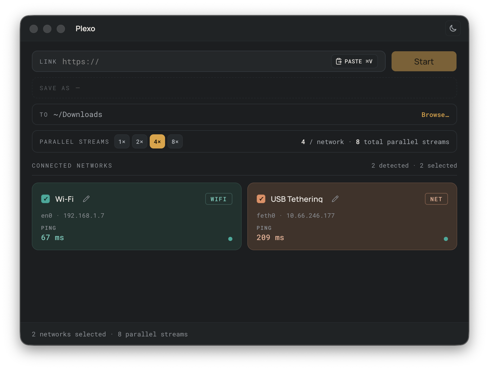
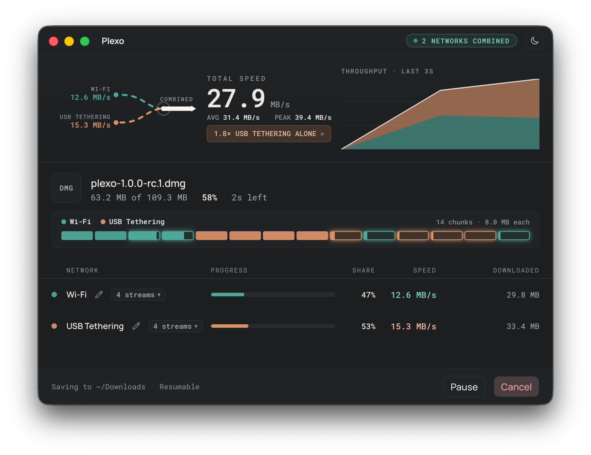
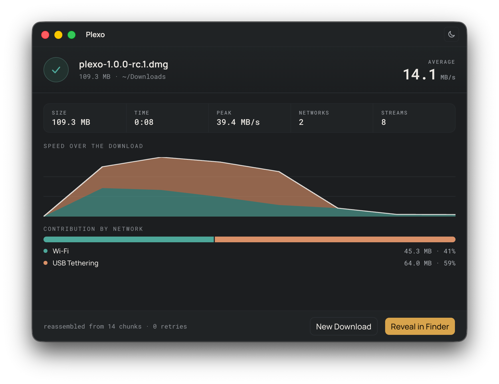

# Plexo Download Manager

[](https://github.com/SheedaMusalli/Plexo-For-Windows/releases/latest)
[](LICENSE)

Plexo is a Windows download manager with a Chrome and Edge companion extension. It can split a supported download into parallel parts and route those requests through the network connections you select, then assemble them into one file.

This repository contains the Windows x64 release and its source. Plexo is based on the original [Plexo project by Anmol Kapil](https://github.com/anmolkapil/plexo); its MIT license is included. This Windows build and its browser integration are maintained by Sheeda Musalli.



## Download Plexo

Get the latest installer and companion extension from the [GitHub Releases page](https://github.com/SheedaMusalli/Plexo-For-Windows/releases/latest). The first public release includes:

- **Windows installer** — installs the Plexo desktop app and browser native-messaging helper.
- **Chrome extension CRX and ZIP** — the ZIP is the recommended way to install this privately distributed extension.
- **Source archive** and **SHA-256 checksums** for the release files.

The installer is not Authenticode-signed with a publisher certificate, so Windows may show an unknown-publisher or SmartScreen warning. The CRX package signature does not mean the extension is published or approved by the Chrome Web Store.

## Install the desktop app and extension

1. Download and run the Plexo Windows installer.
2. Download the `Plexo-Chrome-…zip` release asset and extract it to a folder you plan to keep.
3. Open `chrome://extensions` in Chrome or `edge://extensions` in Edge, turn on **Developer mode**, choose **Load unpacked**, and select the extracted folder containing `manifest.json`.
4. Pin **Plexo Download Manager** from the browser’s Extensions menu. Open its popup and check that it says **Connected**.
5. Use a supported direct download link or a direct media control on a page. Plexo asks before accepting a browser download and shows the transfer in the desktop app.

Chromium browsers restrict installation of most extensions outside their official stores. If your browser refuses the CRX file, install the ZIP with **Load unpacked** as described above. Keep the extracted folder in place; the browser loads the extension from that folder.

## What Plexo does

- **Parallel downloads across selected networks.** Plexo can use separate Internet connections—such as home Wi-Fi and mobile tethering—to fetch parts of the same file. Servers that support HTTP range requests can use multiple streams; other servers fall back to a single stream.
- **Adaptive transfer and recovery.** Workers share a queue of file ranges, retry temporary failures, and can pause and resume. An interrupted desktop download is restored as paused when Plexo starts again.
- **Browser handoff.** The extension can capture supported direct downloads, offer a context-menu action for links, and show controls next to directly downloadable audio or video. The original browser download remains the fallback when Plexo cannot accept a link.
- **YouTube format selection.** On supported YouTube pages, the extension can show available video qualities. Plexo downloads the selected media through its desktop transfer engine and combines video and audio when needed. The final video uses the video title as its filename.
- **One-time scheduling and sequential batches.** Add one or more direct links in the desktop app, optionally choose a start time, and Plexo processes the batch in order. You can review and cancel queued items. Plexo must remain open and the PC must be awake when the scheduled time arrives.
- **Transfer visibility.** See speed, progress, network contribution, and stream activity; open a finished file or reveal it in Explorer. Plexo also includes light and dark themes and network-name/color settings.





## When multiple networks help

Plexo needs genuinely separate routes to the Internet to combine bandwidth. For example, Wi-Fi through a home router and USB-tethered mobile data can use different connections. Wi-Fi and Ethernet connected to the same router normally share one broadband connection, so selecting both will not make that broadband service faster.

The result also depends on the download server. It may limit parallel requests, ignore range requests, or cap the total speed. Plexo cannot guarantee a speed increase for every file or network setup.

## Compatibility and limitations

Plexo is designed for direct HTTP or HTTPS file downloads. Support varies by site and link:

- Sign-in pages, anti-bot challenges, expired links, and some cross-site authentication flows may need to stay in the browser.
- DRM-protected media, HLS/DASH playlists, `blob:` and `data:` links, POST-generated downloads, and private browsing are not supported by the general browser handoff.
- YouTube access depends on the video, region, and current account/session requirements. Some videos may fail to resolve or download.
- A scheduled or queued URL can expire before Plexo reaches it.
- This project does not provide full IDM/FDM compatibility with every website.

For additional Windows setup, privacy, and troubleshooting details, see [WINDOWS-SETUP.md](WINDOWS-SETUP.md). The build and test record is in [VALIDATION.md](VALIDATION.md).

## Privacy and permissions

The browser extension requests broad site access so it can detect supported downloads and direct media on pages. It uses Chrome Native Messaging to communicate with the locally installed Plexo helper; it does not add a web-accessible local HTTP server. Recent request headers can be used to preserve authentication for a matching download, and credentials in Plexo’s persisted browser queue are encrypted with Windows credential storage. Incognito requests are excluded.

YouTube sign-in cookies are only sent for the explicit YouTube retry that asks to use the current browser session. They are used for metadata resolution and are not stored in the download queue. See [WINDOWS-SETUP.md](WINDOWS-SETUP.md#privacy-and-local-storage) for the detailed data flow.

## Build from source

The published installer targets Windows x64. To build it yourself, use Windows 10 or 11, Node.js 22.12 or newer, npm, and Windows PowerShell. The Windows build also compiles the browser helper and prepares the media tools used by YouTube downloads.

```powershell
git clone https://github.com/SheedaMusalli/Plexo-For-Windows.git
cd Plexo-For-Windows
npm ci
npm run dev
```

To create the Windows installer and browser extension packages:

```powershell
npm run build:win
```

Build artifacts are written to `release/`. See [THIRD-PARTY-MEDIA.md](THIRD-PARTY-MEDIA.md) for bundled media-tool sources and licenses. Preserve the local `.signing/extension.pem` key if you rebuild and want to keep the same extension ID; do not publish that private key.

## Checks

```powershell
npm run lint
npm run typecheck
npm run test:e2e:smoke
```

The browser integration tests use an isolated extension profile and native host. To run them against Microsoft Edge, set `PLEXO_TEST_BROWSER` to the Edge executable path before running the relevant Playwright tests. See [CONTRIBUTING.md](CONTRIBUTING.md) for test and development notes.

## Credits and license

Plexo is based on the MIT-licensed work of [Anmol Kapil](https://github.com/anmolkapil/plexo). This Windows release and its browser integration are maintained by **Sheeda Musalli**. See [LICENSE](LICENSE) for license terms.
